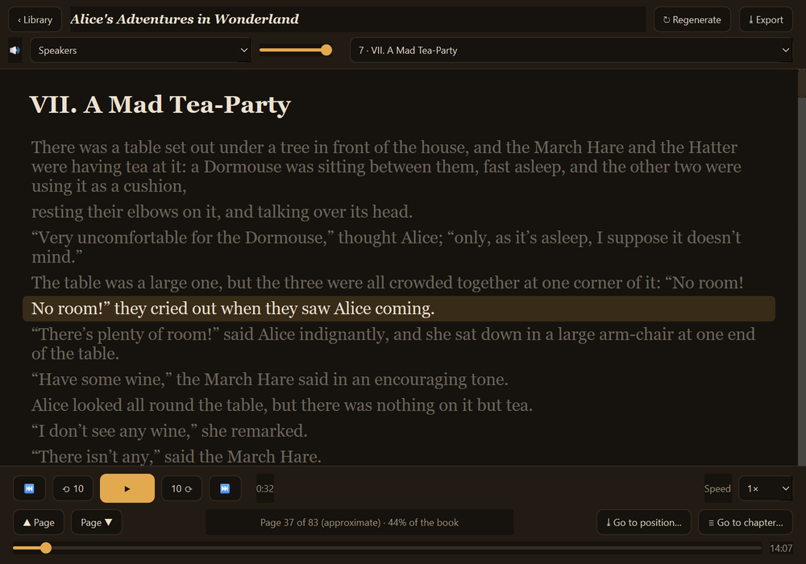
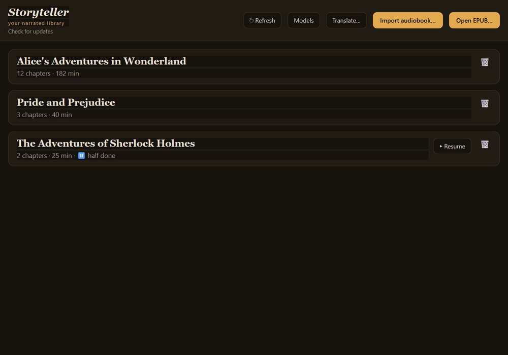
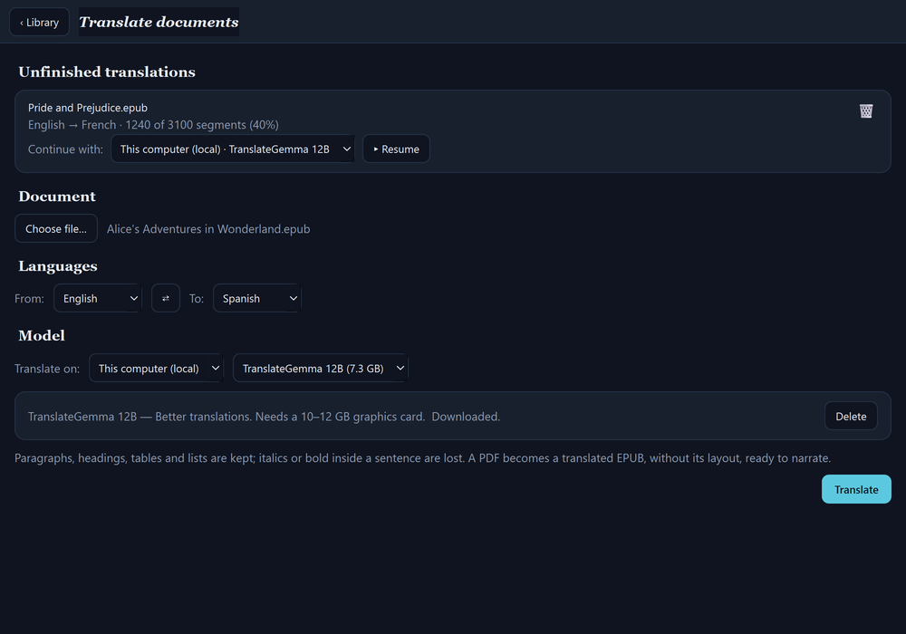
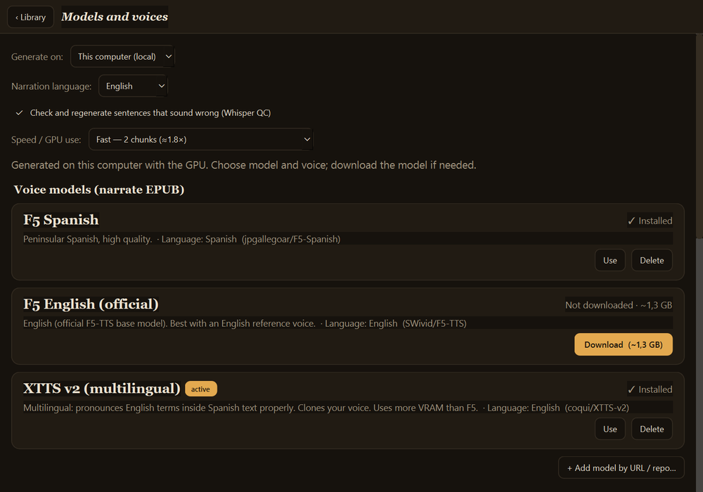

# Storyteller

[English version](README.md)

  
  

Aplicación de escritorio (PySide6) que convierte **EPUB en audiolibro narrado** con
voz neural y lo reproduce con **subtítulos sincronizados** (la frase que suena se
resalta; clic para saltar). También **importa audiolibros existentes** y los
**transcribe con Whisper** para generar esos subtítulos, y **traduce libros y documentos**
entre 15 idiomas con TranslateGemma.

Todo corre **en local** (GPU o CPU) o, si quieres, en un **servidor propio** por SSH.
Los **modelos y las voces no vienen incluidos**: se **descargan desde la propia app**.

## Características

- **Narrar un EPUB** con TTS neural, eligiendo motor en *Modelos*:
  - **XTTS v2 multilingüe** (coqui-tts): lee la frase entera de una pasada y pronuncia
    bien las palabras en otro idioma dentro del texto (p. ej. inglés en un libro en
    español). Clona la voz a partir de un audio de referencia.
  - **F5-TTS** (Español o Inglés): un modelo por idioma.
- **Tramos en paralelo** (1, 2 o 3): reparte los capítulos entre varios procesos en la
  misma GPU; con XTTS, 3 tramos narran unas 2,5 veces más rápido.
- **Tiempo restante** en la barra de progreso («quedan ~1 h 10 min, hacia las 14:35»),
  calculado con el ritmo real de cada tramo.
- **Control de calidad (QC) con Whisper**: transcribe cada frase narrada y la regenera
  si faltan palabras, se inventa texto o entra en bucle repitiendo.
- **Texto preparado para la voz**: números en palabras en el idioma del modelo, siglas
  deletreadas, MAYÚSCULAS, puntuación, y un **diccionario de pronunciación** editable
  (`pron.json`) para las palabras que suenen mal.
- **Importar un audiolibro** (mp3/m4a/…) y transcribirlo con Whisper → subtítulos
  con tiempos. Idioma seleccionable o autodetección.
- **Reproductor** con subtítulos sincronizados, autoscroll, control de velocidad,
  saltos, ir a capítulo/posición y **marcador de escucha** (retoma donde lo dejaste).
- **Escuchar mientras narra**: *Escuchar* en la barra de narración abre el libro en curso;
  el reproductor añade solo las frases y capítulos nuevos y, cuando alcanza lo narrado,
  espera y sigue en el punto exacto.
- **Detener y guardar / Reanudar** tanto la narración como la transcripción, también con
  otro modelo (lo ya hecho se conserva; van por
  bloques y guardan el progreso; se continúan desde la misma frase). Cerrar la app
  durante una narración equivale a «Detener y guardar».
- **Biblioteca**: reanudar libros a medias, **regenerar** uno desde su EPUB original y
  borrarlo.
- **Traducir documentos** (botón *Traducir…*) con **TranslateGemma**: EPUB, PDF, Word,
  PowerPoint, Excel, subtítulos (SRT/VTT), TXT y Markdown, entre los idiomas de la
  interfaz. Conserva párrafos, títulos, tablas y los tiempos de los subtítulos (las
  cursivas o negritas sueltas dentro de una frase se pierden); un PDF se convierte en un
  EPUB traducido, sin su maquetación. En este equipo (llama.cpp, cargado solo mientras traduce) o en el servidor propio
  (Ollama por SSH). Se puede detener y reanudar, también con otro modelo, y el EPUB
  traducido se manda a narrar con un clic.
- **Gestor de modelos** (pantalla *Modelos*): descargar/borrar modelos de voz (XTTS v2,
  F5) y de transcripción (faster-whisper), elegir idioma, tramos en paralelo y QC, y
  **cargar voces** desde archivo
  o por URL (el texto de referencia se **autotranscribe**). Catálogo de voces
  descargables.

  
  

## Requisitos

- **Python 3.11+** con `PySide6` y `PySide6-Addons` (QtMultimedia, backend ffmpeg).
- **ffmpeg** y **ffprobe** y **curl** en el `PATH`.
- Motor F5/Whisper en `engine/.venv` (PyTorch, `f5-tts`, `faster-whisper`,
  `num2words`). Para GPU NVIDIA, PyTorch con CUDA.
- Motor XTTS en un venv aparte, `engine/.venv-xtts` (sus dependencias chocan con las de
  F5): `torch==2.8.0` + `torchaudio==2.8.0` + `coqui-tts` + `faster-whisper` (para el
  QC), **sin** `torchcodec` (torch ≥ 2.9 lo exige y en Windows falla).

- Traducción: se instala sola desde su pantalla (`engine/.venv-translate` y
  `engine/llama.cpp`). En modo servidor, Ollama en el servidor.

Los pesos de los modelos y las voces se descargan desde *Modelos* a `~/cuentacuentos/`
(no están en el repositorio).

## Uso

- **Windows:** `Storyteller.bat` (o `pythonw storyteller.py`).
- **Linux/macOS:** `./storyteller.sh` (o `python3 storyteller.py`).

Argumentos: `storyteller.py <libro.epub>` genera, `--book <carpeta>` abre uno hecho.

**Idiomas de la interfaz (15):** inglés, español, portugués, francés, alemán, italiano,
neerlandés, polaco, ruso, ucraniano, chino, japonés, coreano, tailandés e hindi. Sigue el
idioma del sistema (inglés si no está en la lista); para forzar uno, `--lang xx`
(p. ej. `--lang de`) o la variable de entorno `STORYTELLER_LANG`.

## Estructura

- `storyteller.py` — la aplicación (biblioteca + reproductor + gestor de modelos).
- `st_lang.py` + `i18n/<idioma>.txt` — traducciones de la interfaz (una línea `NN|texto`
  por texto; se comprueban al cargar: que estén todos y con los mismos `{n}`).
- `engine/cc_engine.py` — motor local: `download` / `generate` (F5), `count`
  (capítulos y frases, para repartir tramos y estimar el tiempo), `whisper-download` /
  `whisper` (transcripción en streaming) y la preparación del texto común a los motores.
- `engine/cc_xtts.py` — motor XTTS v2: `generate` / `count`, mismo formato de salida
  (mp3 + subtítulos + manifest, incremental y reanudable).

- `st_translate.py` + `engine/cc_translate.py` — pantalla y motor de traducción de
  documentos (un lector/escritor por formato; guarda el progreso y reanuda).

El modo *Servidor propio* usa un motor equivalente en el servidor por SSH (no incluido).

## Seguridad

Escaneo continuo con **Trivy** (`.github/workflows/trivy.yml`): vulnerabilidades,
secretos y malas configuraciones en cada push/PR.

## Licencia

MIT. Ver [LICENSE](LICENSE). Los componentes y modelos que se descargan aparte conservan
su propia licencia: ver [NOTICE](NOTICE).
