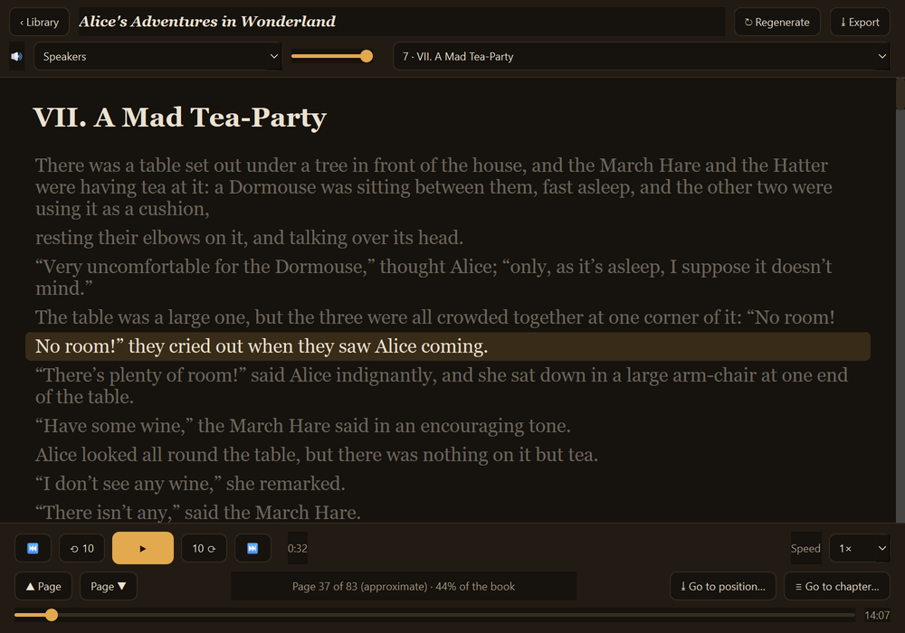
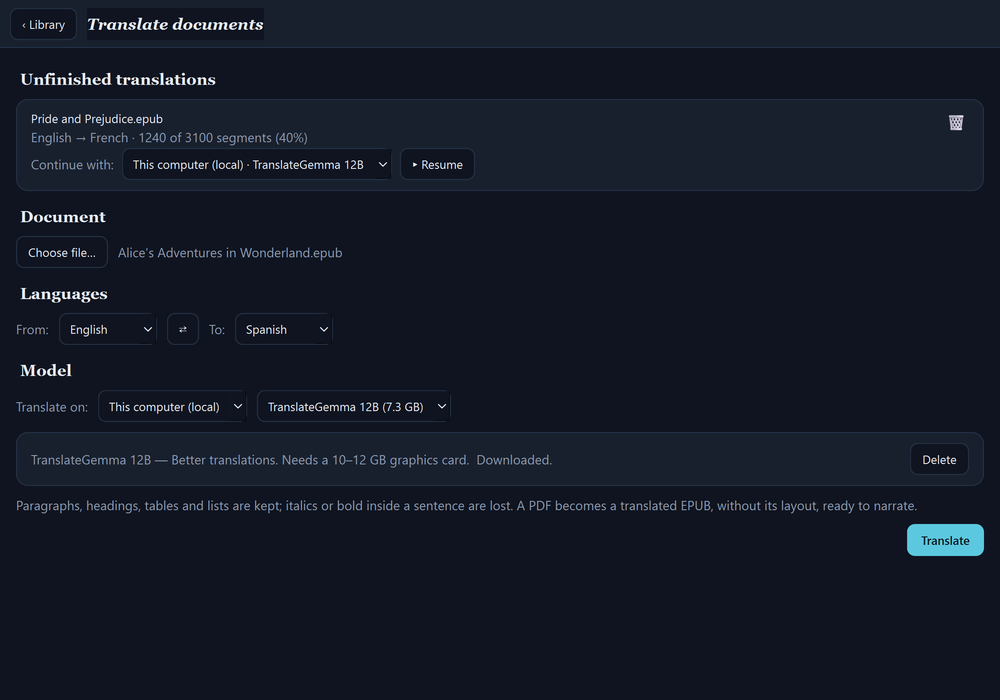
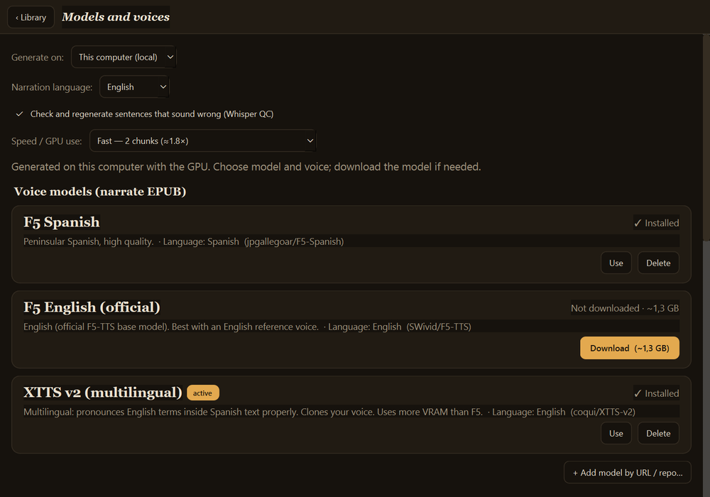

# Storyteller

[Versión en español](README.es.md)

<p align="center">
  
  
</p>

Desktop app (PySide6) that turns an **EPUB into a narrated audiobook** with a neural
voice, in the language you choose (17 available with XTTS), and plays it with **synced
subtitles** (the sentence being read is highlighted; click to jump). It also **imports
existing audiobooks** and **transcribes them with Whisper** to make those subtitles, and
**translates books and documents** between 15 languages with TranslateGemma.

Everything runs **locally** (GPU or CPU) or, if you like, on **your own server** over SSH.
Narration can also use **any voice service by URL**: your own or a public one with its key.
**Models and voices are not bundled**: they are **downloaded from inside the app**. To narrate you only need
XTTS or a voice service; **F5 and Whisper are optional** and are installed apart, only if you want them.

## Features

- **Narrate an EPUB** with neural TTS, choosing the engine in *Models*:
  - **XTTS v2 multilingual** (coqui-tts): reads the whole sentence in one go and
    pronounces foreign words in the text properly (e.g. English inside a Spanish book).
    Clones the voice from a reference recording. Narrates in **17 languages**, chosen in
    *Models*: English, Spanish, French, German, Italian, Portuguese, Dutch, Polish, Czech,
    Hungarian, Turkish, Russian, Arabic, Hindi, Chinese, Japanese and Korean.
  - **F5-TTS** (Spanish or English, optional, installed apart): one model per language.
  - **A voice service by URL**: your own XTTS with `st_server.py` ([API](docs/server-api.md))
    or a public service with its key, with several **requests at a time**. There your own
    server can also receive new voices and hand finished books to other apps.
- **Reads on, with the book's pauses**: each sentence goes to the voice whole, so it flows
  through its commas, and the pauses after a full stop and a paragraph are set by the book's
  punctuation. Only a very long sentence is split, at the comma nearest the model's limit.
- **Parallel chunks** (1, 2 or 3): splits the chapters between several processes on the
  same GPU; with XTTS, 3 chunks narrate about 2.5 times faster.
- **Time left** in the progress bar ("~1 h 10 min left, done around 14:35"), worked out
  from each chunk's real pace.
- **Quality check (QC) with Whisper** (optional, installed apart): transcribes every narrated sentence and
  regenerates it when words are missing, text is made up or it gets stuck repeating. It also
  measures the audio, because Whisper doesn't hear babbling without words. With a voice service by URL, it
  checks what arrives with a Whisper by URL, with its own key, or with the Whisper in the XTTS or F5 environment on
  this computer; asking for a sentence again takes longer and, on a paid service, costs more.
- **Text prepared for the voice**: numbers spelled out in the language being narrated,
  acronyms spelled letter by letter, CAPITALS, punctuation, and an editable
  **pronunciation dictionary** (`pron.json`, with a part for each language) for words that
  sound wrong.
- **Import an audiobook** (mp3/m4a/…) and transcribe it with Whisper (optional, installed apart) → timed subtitles.
  Language can be chosen or detected.
- **Player** with synced subtitles, speed control, skips, go to chapter/position and a
  **listening bookmark** (picks up where you left off). It shows the **page** being read, the
  printed book's own when the EPUB carries it, and the text **follows the voice**: scroll away by
  hand and it comes back to the line being read after five seconds.
- **Listen while it narrates**: *Listen* in the narration bar opens the book in progress;
  the player adds new sentences and chapters by itself and, when it catches up, waits
  and carries on from the exact spot.
- **Stop and save / Resume** both narration and transcription, even with another model
  (what is already done is kept; they work in blocks and
  save progress; they carry on from the same sentence). Closing the app during a
  narration is the same as *Stop and save*. One job runs at a time: resuming another book
  asks whether to stop the current one, which stays saved, and switch to it.
- **Library**: resume half-done books, **regenerate** one from its original EPUB, and
  delete it.
- **Translate documents** (*Translate…* button) with **TranslateGemma**: EPUB, PDF, Word,
  PowerPoint, Excel, subtitles (SRT/VTT), TXT and Markdown, between the interface
  languages. Paragraphs, headings, tables and subtitle timings are kept (italics or bold
  inside a sentence are lost); a PDF becomes a translated EPUB, without its layout. On
  this computer (llama.cpp, loaded only
  while translating) or on your own server (Ollama over SSH). It can be stopped and
  resumed, even with another model, and the translated EPUB can be sent to narration
  with one click.
- **Model manager** (*Models* screen): download/delete voice models (XTTS v2, F5) and
  transcription models (faster-whisper), with a progress bar (size, speed, time left) and *Cancel*, choose the narration language, parallel chunks and QC,
  and **load voices** from a file or a URL (the reference text is **transcribed
  automatically**). Catalogue of downloadable voices.
- **Check for updates** button in the library: asks GitHub only when you press it and installs the new
  version without touching your books, settings, voices or models ([Updating](#updating)).

<p align="center">
  
  
</p>

## Requirements

- **Python 3.11, 3.12 or 3.13**. Storyteller has not been tested on 3.14.
- **ffmpeg**, **ffprobe** and **curl** on the `PATH`.
- `PySide6` and `PySide6-Addons` (QtMultimedia, ffmpeg backend), from `requirements.txt`.
- The engines you want, each in its step under [Installation](#installation). Only XTTS, or a voice service, is
  needed to narrate; **F5 and Whisper are optional**.
- Translation: installs itself from its own screen (`engine/.venv-translate` and
  `engine/llama.cpp`). In server mode, Ollama on the server.

Model weights and voices are downloaded from *Models* into `~/cuentacuentos/` (they are
not in the repository).

## Installation

The app always looks for its engines, models and books in `~/cuentacuentos`, so the clone
has to go in that folder. In a terminal (PowerShell on Windows):

```sh
cd ~
git clone https://github.com/javimentallab/Storyteller.git cuentacuentos
cd cuentacuentos
python -m pip install -r requirements.txt
```

On Linux/macOS use `python3`. If Linux refuses with `externally-managed-environment`, install
PySide6 in a venv of its own and start the app from the terminal where it is active:

```sh
python3 -m venv ~/storyteller-app
. ~/storyteller-app/bin/activate
python3 -m pip install -r requirements.txt
```

Then the engines. Install only what you are going to use:

| You want to | Install |
|---|---|
| Narrate on this computer | [XTTS](#xtts) |
| Narrate and check every sentence (QC) | [XTTS](#xtts), then [Whisper](#whisper-optional) in its environment |
| Transcribe audiobooks, without narrating here | [Whisper](#whisper-optional) on its own |
| Narrate with a voice service by URL | [Reading the EPUB](#reading-the-epub), or XTTS if you already have it |
| Narrate on your own server | Nothing here |
| Narrate with an F5 model | [F5](#f5-optional) |

The commands run from the `cuentacuentos` folder. XTTS and F5 take several GB. Install PyTorch first, as shown,
so that pip does not bring a newer version. Without an NVIDIA GPU, change `cu130` to `cpu` in its `--index-url`.
CUDA 13.0 needs an NVIDIA driver 580 or later.

### XTTS

The multilingual voice, in its own environment. Windows:

```powershell
python -m venv engine\.venv-xtts
engine\.venv-xtts\Scripts\python -m pip install torch==2.13.0 --index-url https://download.pytorch.org/whl/cu130
engine\.venv-xtts\Scripts\python -m pip install -r engine\deps\xtts\requirements.txt
```

Linux/macOS:

```sh
python3 -m venv engine/.venv-xtts
engine/.venv-xtts/bin/python -m pip install torch==2.13.0 --index-url https://download.pytorch.org/whl/cu130
engine/.venv-xtts/bin/python -m pip install -r engine/deps/xtts/requirements.txt
```

To narrate in Japanese or Chinese, add this. Windows:

```powershell
engine\.venv-xtts\Scripts\python -m pip install -r engine\deps\xtts-languages\requirements.txt
```

Linux/macOS:

```sh
engine/.venv-xtts/bin/python -m pip install -r engine/deps/xtts-languages/requirements.txt
```

### Whisper (optional)

For transcribing audiobooks and for the quality check (QC). It goes **in the environment of the engine that
narrates**, because the QC runs in that process; from there it also transcribes. Without Whisper you can still narrate,
without the QC, and a voice's reference text is typed by hand.

With XTTS, for the QC and transcribing. Windows:

```powershell
engine\.venv-xtts\Scripts\python -m pip install -r engine\deps\whisper\requirements.txt
```

Linux/macOS:

```sh
engine/.venv-xtts/bin/python -m pip install -r engine/deps/whisper/requirements.txt
```

With F5, the same in its environment. Windows:

```powershell
engine\.venv\Scripts\python -m pip install -r engine\deps\whisper\requirements.txt
```

Linux/macOS:

```sh
engine/.venv/bin/python -m pip install -r engine/deps/whisper/requirements.txt
```

Without any engine, only to transcribe. Windows:

```powershell
python -m venv engine\.venv
engine\.venv\Scripts\python -m pip install -r engine\deps\whisper\requirements.txt
```

Linux/macOS:

```sh
python3 -m venv engine/.venv
engine/.venv/bin/python -m pip install -r engine/deps/whisper/requirements.txt
```

On its own it transcribes on the CPU. It uses an NVIDIA graphics card if that environment has PyTorch with CUDA, as
those of XTTS and F5 do; to add it to `engine/.venv`, use the PyTorch command from [F5](#f5-optional).

### Reading the EPUB

Enough to narrate with a voice service by URL. XTTS and F5 already bring it. Windows:

```powershell
python -m venv engine\.venv
engine\.venv\Scripts\python -m pip install -r engine\deps\base\requirements.txt
```

Linux/macOS:

```sh
python3 -m venv engine/.venv
engine/.venv/bin/python -m pip install -r engine/deps/base/requirements.txt
```

### F5 (optional)

Only to narrate with an F5 model. It brings packages under other licences, such as a non-commercial one
([NOTICE](NOTICE)), which stay out if you don't install it. Windows:

```powershell
python -m venv engine\.venv
engine\.venv\Scripts\python -m pip install torch==2.13.0 --index-url https://download.pytorch.org/whl/cu130
engine\.venv\Scripts\python -m pip install --no-deps -r engine\deps\f5\requirements.txt
```

Linux/macOS:

```sh
python3 -m venv engine/.venv
engine/.venv/bin/python -m pip install torch==2.13.0 --index-url https://download.pytorch.org/whl/cu130
engine/.venv/bin/python -m pip install --no-deps -r engine/deps/f5/requirements.txt
```

It is installed with `--no-deps` to leave out `gradio`, F5's web interface, which Storyteller doesn't use, and to get past the
limits that `gradio` and `cached-path` put on `pillow` and `filelock`, whose older versions have known vulnerabilities. So
`pip check` complains about `gradio` and `cached-path`: that is expected, not a fault.

Then start the app and download the models from *Models*. If an engine is missing, its card there
says so and gives the commands, and the screen notices a new engine the next time you open it, without restarting.
An installation from an earlier version, with everything in `engine/.venv` and `engine/.venv-xtts`, keeps working as it is.

## Usage

- **Windows:** `Storyteller.bat` (or `pythonw storyteller.py`).
- **Linux/macOS:** `./storyteller.sh` (or `python3 storyteller.py`).

Arguments: `storyteller.py <book.epub>` generates, `--book <folder>` opens a finished one.

**Interface languages (15):** English, Spanish, Portuguese, French, German, Italian,
Dutch, Polish, Russian, Ukrainian, Chinese, Japanese, Korean, Thai and Hindi. It follows
the system language (English if it is not in the list); to force one, use
`--lang xx` (e.g. `--lang de`) or the `STORYTELLER_LANG` environment variable.

### Updating

**Check for updates**, under the Storyteller name in the library, asks GitHub for the latest release only when
you press it: the app never checks in the background. It sends no personal data, only the
`Storyteller-updater/<version>` User-Agent. If there is a newer version, it says which one and asks before it
changes anything:

- In a git clone, like the one in [Installation](#installation), it updates with git: it fetches the release tag
  from the official repository (`https://github.com/javimentallab/Storyteller`, whatever your `origin` is) and
  moves the clone forward to it with a fast-forward only, then restarts. If the clone has uncommitted changes or
  commits of its own, or git cannot be found, it changes nothing, says why and offers the release page.
- In a folder installed from a release's archive, it downloads that release's archive from this repository,
  verifies its SHA-256 checksum when the release publishes one and replaces only the program files. Your settings,
  books and the progress of each narration, voices, models and engine environments are not in the archive and are
  never written, so nothing is downloaded again. The previous files are kept in `.update/backup-<version>`. The app
  then restarts.
- If the program is not in `~/cuentacuentos`, or that folder cannot be written to, it changes nothing: a copy that
  is not a git clone gets the archive saved in your Downloads folder, and the release page opens.
- If a narration, transcription, translation or model download is in progress, it only tells you that there is a
  new version: finish or stop that first.

If a release changes the `requirements.txt` of an engine, the app says so: repeat that engine's installation step.

## Layout

- `storyteller.py` — the app (library + player + model manager).
- `st_lang.py` + `i18n/<lang>.txt` — interface translations (one `NN|text` line per
  text; checked on load: all texts present and the same `{n}` placeholders).
- `requirements.txt` and `engine/deps/<engine>/requirements.txt` — the exact versions of the interface and of each engine.
- `engine/cc_engine.py` — local engine: `download` / `generate` (F5), `count`
  (chapters and sentences, to split chunks and estimate the time), `whisper-download` /
  `whisper` (streaming transcription) and the text preparation shared by the engines.
- `engine/cc_xtts.py` — XTTS v2 engine: `generate` / `count`, same output format
  (mp3 + subtitles + manifest, incremental and resumable).
- `engine/cc_service.py` — narrates by asking a voice service for each sentence, through the
  standard API, same output format. No graphics card or voice model needed on this computer.
- `st_server.py` — that service with your own XTTS and voices, for this app on another computer,
  the mobile app or any other client ([API](docs/server-api.md)).
- `st_update.py` — *Check for updates*: compares versions, downloads a release and installs it (no Qt;
  tested with a simulated network).
- `st_translate.py` + `engine/cc_translate.py` — document translation screen and engine
  (one reader/writer per format; saves progress and resumes).

*Own server* mode uses an equivalent engine on the server over SSH (not included).

## Security

Continuous scanning with **Trivy** (`.github/workflows/trivy.yml`): vulnerabilities,
secrets and misconfigurations on every push/PR and every week, including every `requirements.txt`. **CodeQL** analyzes the code,
the tests run in CI, and every Action is pinned by commit.

## Contributing

See [CONTRIBUTING](CONTRIBUTING.md). To report a security problem privately, see [SECURITY](SECURITY.md).

## License

MIT. See [LICENSE](LICENSE). Components and models that are downloaded separately keep
their own licence: see [NOTICE](NOTICE). Version history: [CHANGELOG](CHANGELOG.md).
